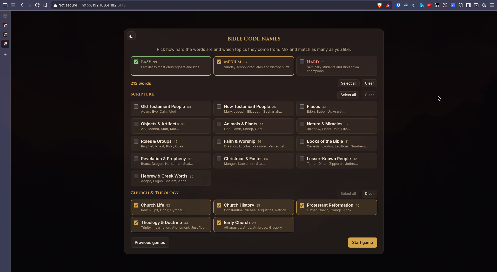
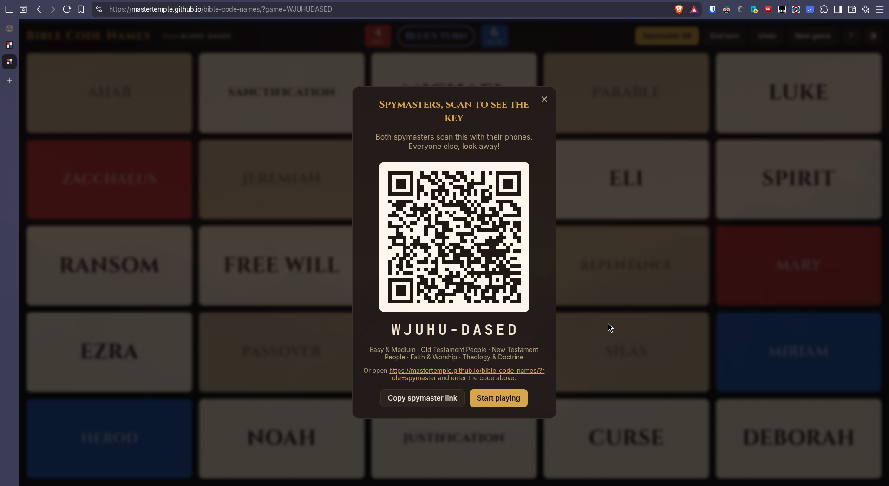
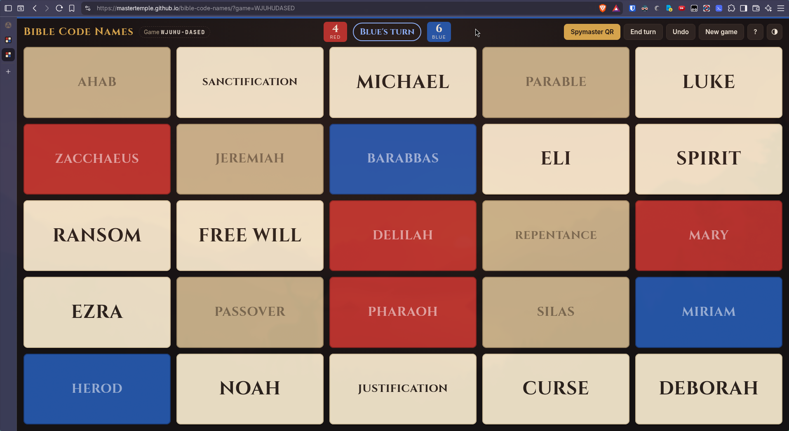
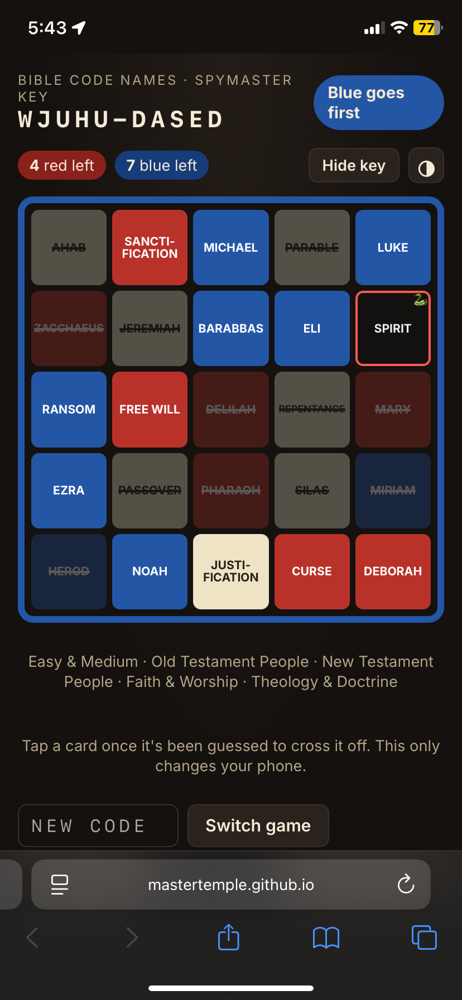

# Bible Code Names

**Play it at https://mastertemple.github.io/bible-code-names/**

1. Create a new game:



2. Spymasters Joins with QR Code:



3. Make your guesses:

<p>
  
  
</p>

A Codenames-style party word game with about 870 words. It's a static site with no backend. Hosts choose two things separately:

- **Topics** (18, mix and match). _Scripture:_ Old & New Testament people, places, objects, animals & plants, nature & miracles, roles, faith & worship, books of the Bible, Revelation & prophecy, Christmas & Easter, lesser-known people, Hebrew & Greek words. _Church & Theology:_ church life, church history, the Protestant Reformation, theology & doctrine, the early church.
- **Difficulty** (easy, medium, hard, in any combination). Each word has its own rating, based on how well known it is. So an easy Reformation board gets Luther and Hammer, and a hard one gets Melanchthon and Tetzel.

## How the shared game works

Every game has a code, like `HXK7P-4G`. The first 5 characters are random. The rest record the settings, as bitmasks with 5 bits per character:

- **All difficulties:** just the topics, in 2 to 4 characters. This format is unchanged from before difficulties existed, so those older codes still produce the same boards.
- **Some difficulties:** 1 character for the difficulties, then 4 or more for the topics, for example `HXK7P-BAAAD`. A seeded random number generator turns the code into the same 25 words, the same key card, and the same starting team on every device. The hyphen is only for display, so `HXK7P4G` works too.

| View                           | URL                            |
| ------------------------------ | ------------------------------ |
| Main board (TV or laptop)      | `?game=HXK7P4G`                |
| Spymaster key (phones)         | `?game=HXK7P4G&role=spymaster` |
| Start screen (category picker) | no `game` parameter            |
| Spymaster code entry           | `?role=spymaster`              |

Hosts pick categories when they start a game; the selection is remembered for next time. When you start a new game, the board shows a QR code that links to the spymaster view. Spymasters can also type the code on the code-entry page.

Board progress (guesses, turns, undo) is saved in that browser's `localStorage`, so refreshing the page doesn't lose the game. On their own phones, spymasters can tap words to cross them off once they've been guessed.

Every board or spymaster key a device opens goes into its **Previous games** list, kept in `localStorage` (newest first, up to 30). The list shows each game's progress and categories. You can open it from the start dialog, the landing page, and the spymaster screens. Each entry reopens in the view it was used in, and you can remove entries one at a time or all at once.

There's a light theme and a dark theme. The theme button cycles between System (follow the device setting), Light and Dark, and each device remembers its own choice. The button is on the board, the spymaster screens and the start dialog.

The key is hidden only by the honor system. Anyone who knows the code and adds `&role=spymaster` to the URL can see it.

## Develop

```sh
npm install
npm run dev      # serves on your LAN; open the "Network" URL so phones can reach the QR link
npm run build    # outputs static files to dist/
```

`dist/` uses relative paths, so it can be hosted from any static host or sub-path (GitHub Pages, Netlify, S3, etc.).

## Editing words

The words live in `src/words.ts`, grouped into `CATEGORIES`. Boards are built from those lists, so changing them changes what existing codes produce. Make sure the host and the spymasters are on the same deployed version.

- A category's position in the list is its bit in the game code. Add new categories at the end, and don't reorder existing categories or the words inside them. The start dialog groups topics by their `group`, so their position in the list doesn't affect where they're shown.
- A word is easy unless it appears in its category's `medium` or `hard` list. Re-rating a word only changes codes that leave out one of the difficulties.
- Keep each word to 10 letters or fewer so it stays readable on phones. A longer word needs a soft hyphen (`\u00ad`) where it should break on small screens.
